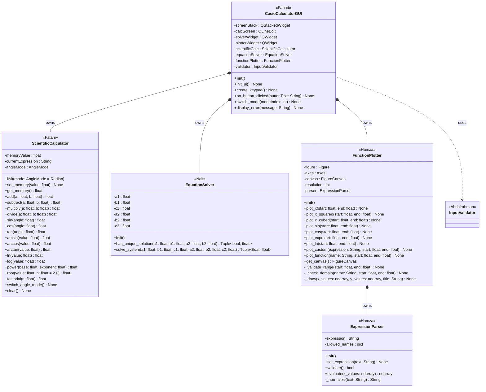

# UML Class Diagram (v1) - EE202 Scientific Calculator
Initial UML for Checkpoint 1. The diagram is written in Mermaid, so GitHub and VS Code (with a Mermaid preview extension) render it directly.

## Class responsibilities

| Class | File | Responsibility |
|---|---|---|
| `CasioCalculatorGUI` | `ui/main_window.py` | Receives user input, navigates between the three screens, displays results and errors |
| `ScientificCalculator` | `core/calculator.py` | Basic and scientific calculations, degree/radian mode, memory |
| `EquationSolver` | `core/solver.py` | Solves two linear equations in two unknowns and detects systems with no unique solution |
| `FunctionPlotter` | `core/plotter.py` | Draws the required functions with Matplotlib and handles invalid ranges and domains |
| `ExpressionParser` | `core/expression_parser.py` | Parses, validates and evaluates user-defined functions for the plotter |
| `InputValidator` | `utils/validator.py` | Validates user input (empty, non-numeric, invalid values) |

## Relationships

- **Composition** (`*--`): `CasioCalculatorGUI` creates and owns the calculator, solver and plotter objects. `FunctionPlotter` creates and owns its `ExpressionParser`.
- **Dependency** (`..>`): `CasioCalculatorGUI` only uses `InputValidator` to check input.
- The `core` package never imports from `ui`, which keeps the GUI separate from the calculation logic.
