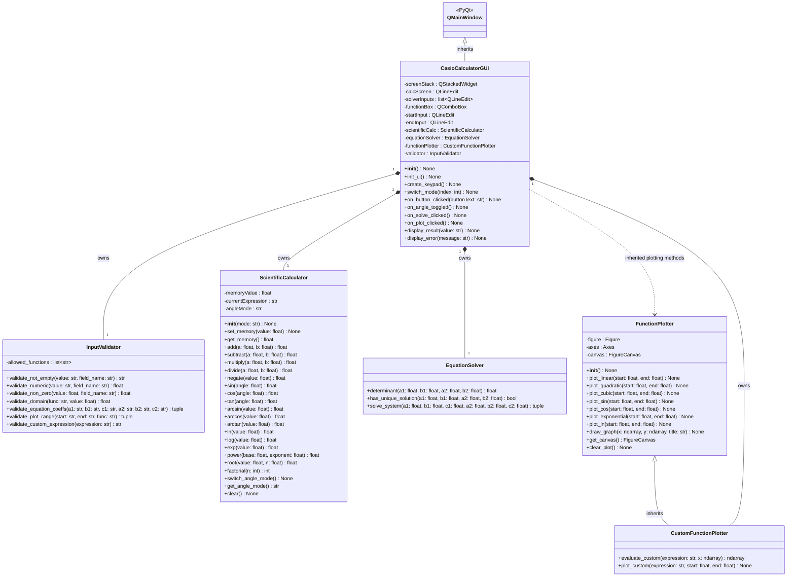

# Scientific Calculator UML

This is the proposed object-oriented architecture for the PyQt scientific calculator. It has **six project classes**: the main GUI, the input validator, scientific calculator, equation solver, the predefined-function plotter, and a child plotter for user-defined expressions. Framework classes (`QMainWindow`, `ValueError`) are not counted among the project's six classes.

## Complete UML Class Diagram

## Class responsibilities and returned values

| Class | Purpose | Important returns |
|---|---|---|
| `CasioCalculatorGUI` | Owns PyQt controls and shows results or errors; calls other objects. | Event handlers return `None` and update widgets. |
| `InputValidator` | Validates empty/numeric inputs, math domains, equation coefficients, plot intervals, and user-entered expressions. | `str`, `float`, `tuple`; raises standard `ValueError` for invalid inputs. |
| `ScientificCalculator` | Implements separate basic/scientific math methods with DEG/RAD mode and memory. | Numeric values (`float`, or `int` for factorial); setters/clear return `None`. |
| `EquationSolver` | Calculates the determinant, checks uniqueness, and solves for x/y. | `float`, `bool`, `(float, float)`; raises `ValueError` when there is no unique solution. |
| `FunctionPlotter` | Implements one public method per built-in function and a shared Matplotlib draw method. | Plot methods return `None`; `get_canvas()` returns a `FigureCanvas`. |
| `CustomFunctionPlotter` | Inherits plotting tools; also evaluates and plots user-entered functions. | `evaluate_custom()` returns NumPy values; `plot_custom()` updates canvas and returns `None`. |

## Main interaction flows

- **Calculator:** Button → `CasioCalculatorGUI.on_button_clicked()` → `InputValidator` (where needed) → appropriate `ScientificCalculator` method → displayed result.
- **Equation solver:** Solve → `InputValidator.validate_equation_coeffs()` → `EquationSolver.solve_system()` → display `x` and `y`.
- **Predefined plot:** Plot → `InputValidator.validate_plot_range()` → selected `FunctionPlotter.plot_*()` method inherited by the custom plotter → shared `draw_graph()`.
- **Custom plot:** Plot → `InputValidator.validate_custom_expression()` and `validate_plot_range()` → `CustomFunctionPlotter.plot_custom()` → inherited `draw_graph()`.

## OOP relationships

- **Inheritance:** `CasioCalculatorGUI` extends Qt's `QMainWindow`, and `CustomFunctionPlotter` extends `FunctionPlotter`.
- **Composition:** GUI constructs and owns validator, calculator, solver, and one `CustomFunctionPlotter` object.
- **Encapsulation:** The internal data such as `angleMode`, plotting `figure/axes/canvas`, and memory are managed through class methods.
- **Reuse:** The child uses the same `draw_graph()` as the predefined plotting methods. Only its method for obtaining `y` from a user expression is new.

## Implementation notes

- The `CustomFunctionPlotter` object handles both built-in and custom plotting, since it inherits all the parent's methods.
- Validate unknown functions, restricted domains (`ln(x)`, etc.), invalid numeric ranges, and non-finite results. Avoid executing arbitrary user strings with unrestricted `eval()`; allow only supported mathematical expressions with a safe parser.
- The diagram is the **proposed design**, not a claim that all methods have already been coded. Update attributes and method signatures to match the final implementation.
- Custom function plotting is an optional enhancement; the seven built-in functions and the other required features must work first.
