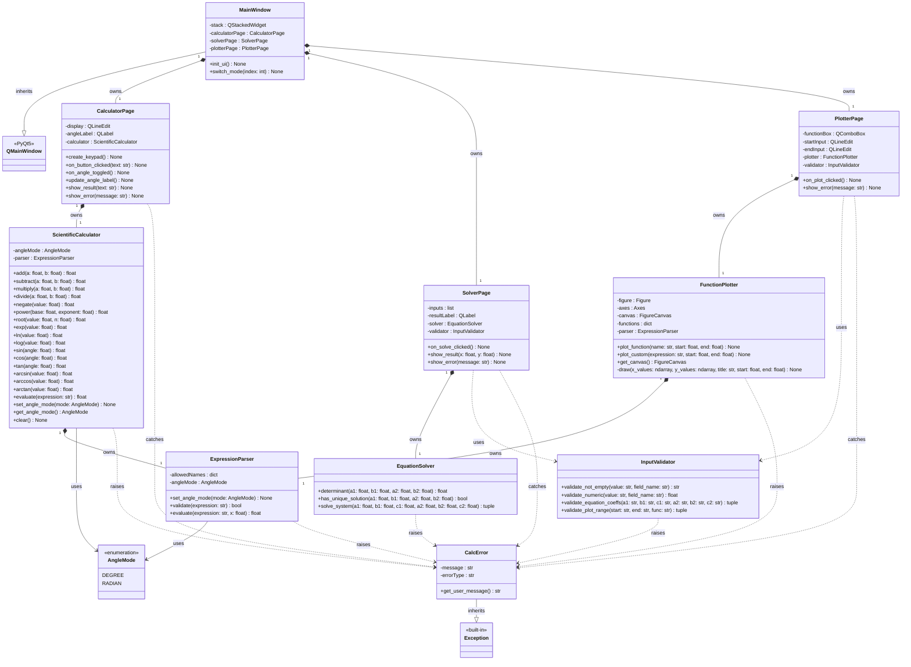

## 3. Initial UML class diagram



## 4. Class responsibilities (why each class exists)

| Class | File | Owner | Responsibility |
|---|---|---|---|
| `MainWindow` | `ui/main_window.py` | Fahad | Main application window (inherits `QMainWindow`). Holds the mode selector and the `QStackedWidget`, and only handles navigation between the three pages. Contains no math. |
| `CalculatorPage` | `ui/calculator_page.py` | Fahad | Calculator screen: display, keypad, DEG/RAD toggle and angle label. Maps each button to a `ScientificCalculator` method, shows results, catches `CalcError`. |
| `SolverPage` | `ui/solver_page.py` | Fahad | Solver screen: six input fields and a Solve button. Reads the text, calls `InputValidator`, then `EquationSolver`, and displays x and y or an error message. |
| `PlotterPage` | `ui/plotter_page.py` | Fahad | Plotter screen: function selector, interval fields, Plot button and the embedded canvas. Validates the range, calls `FunctionPlotter`, shows errors. |
| `ScientificCalculator` | `core/calculator.py` | Fatani | All calculator logic: basic and scientific operations, degree/radian handling and expression evaluation (through its `ExpressionParser`). Raises `CalcError` for division by zero, sqrt of a negative value, ln/log of a non-positive value, etc. |
| `AngleMode` | `core/calculator.py` | Fatani | Enumeration with the two angle modes (`DEGREE`, `RADIAN`), so the mode is a named value and not a loose string. |
| `EquationSolver` | `core/solver.py` | Naif | Solves two linear equations in two unknowns using the determinant. Raises `CalcError` when there is no unique solution. |
| `FunctionPlotter` | `core/plotter.py` | Hamza | Owns the Matplotlib figure and canvas. A dictionary maps each function name to its formula, so one method (`plot_function`) plots any of the required functions. Draws axes labels, grid, title and interval. |
| `ExpressionParser` | `core/expression_parser.py` | Hamza | Safely validates and evaluates expressions (calculator expressions and user-defined f(x)) using only whitelisted names (no raw `eval`). Knows the angle mode so `sin(30)` is correct in degree mode. |
| `InputValidator` | `utils/validator.py` | Abdalrahman | Checks raw text before it reaches the logic classes: empty, non-numeric, equation coefficients, plot range and function domain. Converts text to numbers and raises `CalcError` on failure. |
| `CalcError` | `utils/errors.py` | Abdalrahman | Single custom exception for all application errors. `get_user_message()` gives the pages a text they can show directly. |
| `QMainWindow` / `Exception` | PyQt5 / Python built-in | - | Framework/language base classes of `MainWindow` and `CalcError`. |

## 5. Purpose of the main methods

**MainWindow**

| Method | Purpose |
|---|---|
| `init_ui()` | Creates the window, the mode selector and the stacked pages |
| `switch_mode(index)` | Switches between Calculator, Solver and Plotter pages |

**CalculatorPage**

| Method | Purpose |
|---|---|
| `create_keypad()` | Builds the calculator buttons and connects their signals to slots |
| `on_button_clicked(text)` | Slot for the keypad: maps the pressed button to a `ScientificCalculator` method and shows the result |
| `on_angle_toggled()` | Switches DEG/RAD in the calculator and refreshes the label |
| `update_angle_label()` | Shows the current angle mode to the user |
| `show_result(text)` / `show_error(message)` | Show a result, or a clear error message |

**SolverPage**

| Method | Purpose |
|---|---|
| `on_solve_clicked()` | Slot for Solve: validates the six fields, calls `EquationSolver`, shows the result or an error |
| `show_result(x, y)` / `show_error(message)` | Display the solution or the error message |

**PlotterPage**

| Method | Purpose |
|---|---|
| `on_plot_clicked()` | Slot for Plot: validates function and range, calls `FunctionPlotter`, refreshes the canvas |
| `show_error(message)` | Displays range/domain errors |

**ScientificCalculator**

| Method | Purpose |
|---|---|
| `add`, `subtract`, `multiply`, `divide` | Basic arithmetic; `divide` raises `CalcError` on division by zero |
| `negate`, `power`, `root`, `exp` | Change of sign, powers, roots (`n = 2` gives the square root), exponential |
| `ln`, `log` | Natural and common logarithm; raise `CalcError` for values <= 0 |
| `sin`, `cos`, `tan` | Trigonometric functions; the input is converted according to `angleMode` |
| `arcsin`, `arccos`, `arctan` | Inverse trigonometric functions; the result is returned in the current angle mode |
| `evaluate(expression)` | Evaluates an entered expression such as `2+3*4` through `ExpressionParser` |
| `set_angle_mode`, `get_angle_mode` | Set and read the degree/radian mode (also updates the parser) |
| `clear()` | Resets the calculator state |

**EquationSolver**

| Method | Purpose |
|---|---|
| `determinant(a1, b1, a2, b2)` | Computes a1*b2 - a2*b1 |
| `has_unique_solution(...)` | True when the determinant is not (almost) zero, using a tolerance such as `abs(det) < 1e-12` |
| `solve_system(...)` | Returns (x, y); raises `CalcError` when there is no unique solution |

**FunctionPlotter**

| Method | Purpose |
|---|---|
| `plot_function(name, start, end)` | Single entry point: looks up the function in the `functions` dictionary, generates x and y values and calls `draw` |
| `plot_custom(expression, start, end)` | Optional enhancement: plots a user-defined function through `ExpressionParser` |
| `get_canvas()` | Returns the canvas to embed in the PyQt page |
| `draw(...)` | Common drawing routine: clears the axes, plots, sets labels, grid, title and interval |

**ExpressionParser**

| Method | Purpose |
|---|---|
| `set_angle_mode(mode)` | Sets degree/radian handling for trigonometric names |
| `validate(expression)` | Checks that the text uses only allowed names and operators |
| `evaluate(expression, x)` | Evaluates the expression (for a single value or for an array of x values) |

**InputValidator**

| Method | Purpose |
|---|---|
| `validate_not_empty` | Rejects empty fields |
| `validate_numeric` | Converts text to float or rejects non-numeric input |
| `validate_equation_coeffs` | Validates and converts the six solver fields |
| `validate_plot_range` | Validates start/end (numeric, start < end, inside the domain of the selected function, e.g. x > 0 for ln) |

**CalcError**

| Method | Purpose |
|---|---|
| `get_user_message()` | Returns a user-friendly text for display |

## 6. Relationships and why they were chosen

- **Inheritance** (`--|>`): `MainWindow` extends `QMainWindow` (required by PyQt to create a window) and `CalcError` extends `Exception` (required for `try/except`). Both are needed by the framework/language, so neither is artificial.
- **Composition** (`*--`): `MainWindow` creates and owns the three pages; each page creates and owns its logic class (`ScientificCalculator`, `EquationSolver`, `FunctionPlotter`); `ScientificCalculator` and `FunctionPlotter` each own an `ExpressionParser`. These objects have no use outside their owner and live and die with it.
- **Association** (`-->`): `ScientificCalculator` and `ExpressionParser` use the `AngleMode` enumeration.
- **Dependency** (`..>`): `SolverPage` and `PlotterPage` use `InputValidator` only when a button is pressed. `InputValidator`, `ScientificCalculator`, `EquationSolver`, `ExpressionParser` and `FunctionPlotter` raise `CalcError`; the three pages catch it and display the message.
- The `core` and `utils` packages never import from `ui`, so any logic class can be changed or tested without touching the GUI.
- Note: `FunctionPlotter` owns a Matplotlib `FigureCanvas` (a Qt widget) because the project asks for a plotting class that manages the visualization; the GUI only embeds the canvas through `get_canvas()`.

## 7. Error-handling design (who validates, who raises, who catches)

1. A page reads raw text from its widgets and passes it to `InputValidator`, which checks it and returns clean numbers (or raises `CalcError`). Domain checks on raw input (e.g. plot range for ln) happen here.
2. The logic classes raise `CalcError` as a second line of defence for mathematical problems (division by zero, invalid sqrt/log input, no unique solution, invalid expression, unknown function name).
3. Each page wraps its actions in `try/except CalcError` and calls `show_error(error.get_user_message())`, so the program never terminates because of bad input.

Example flow, pressing `sin`: button click -> `CalculatorPage.on_button_clicked("sin")` -> `ScientificCalculator.sin(value)` -> `show_result(...)`; if `CalcError` is raised -> `show_error(...)`.

## 8. Proposed program/module structure

```
Scientific-Calculator/
├── main.py                      # creates QApplication and MainWindow
├── ui/
│   ├── main_window.py           # MainWindow (navigation)
│   ├── calculator_page.py       # CalculatorPage
│   ├── solver_page.py           # SolverPage
│   └── plotter_page.py          # PlotterPage
├── core/
│   ├── calculator.py            # ScientificCalculator, AngleMode
│   ├── solver.py                # EquationSolver
│   ├── plotter.py               # FunctionPlotter
│   └── expression_parser.py     # ExpressionParser
├── utils/
│   ├── validator.py             # InputValidator
│   └── errors.py                # CalcError
├── tests/                       # test cases (calculator, solver, plotter, validator)
└── docs/
    └── UML_v1.md
```

## 9. Team-member responsibilities

| Member | Main contribution |
|---|---|
| Fahad | PyQt GUI and navigation (`MainWindow`, `CalculatorPage`, `SolverPage`, `PlotterPage`) |
| Fatani | Scientific calculator and calculation engine (`ScientificCalculator`, `AngleMode`) |
| Naif | Equation solver (`EquationSolver`) |
| Hamza | Function plotting (`FunctionPlotter`, `ExpressionParser`) |
| Abdalrahman | Input validation and error handling (`InputValidator`, `CalcError`) |

## 10. OOP concepts used

- **Encapsulation**: attributes are private (`-`) and accessed through methods (e.g. `get_angle_mode`, `get_canvas`).
- **Separation of responsibilities**: navigation, each page, calculation, solving, plotting, parsing and validation are separate classes.
- **Composition**: the window owns the pages, each page owns its logic class, and the calculator and plotter own their parser.
- **Reusability and modularity**: each class sits in its own module and can be tested or extended independently (e.g. a new plot function is one new entry in the `functions` dictionary, without changing the GUI). `ExpressionParser` is reused by both the calculator and the plotter.
- **Inheritance**: used where the framework or language requires it: `MainWindow` from `QMainWindow` and `CalcError` from `Exception`.
